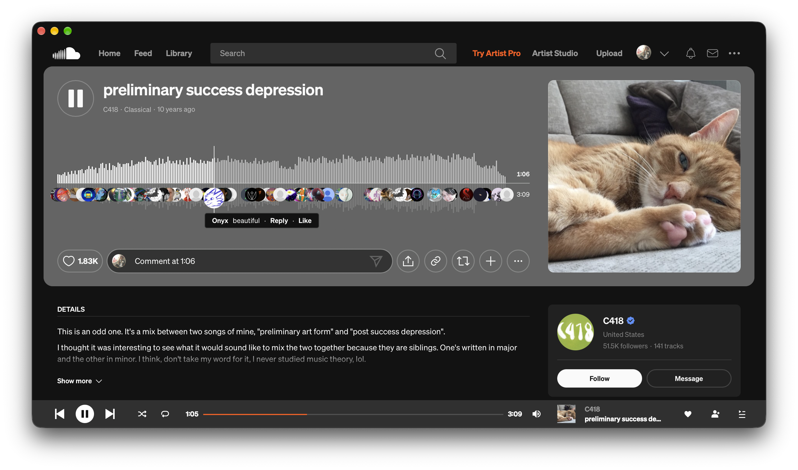

<div align="center">

# SoundCloud for macOS

A lightweight desktop app for SoundCloud that behaves like a real Mac music player.

[](https://github.com/jettsba/SoundCloud-for-macOS/releases/latest)


[](LICENSE)



</div>

SoundCloud has no official Mac app. This one wraps [soundcloud.com](https://soundcloud.com) in a native window and fixes the things that make listening in a browser tab annoying.

## Features

- **Keeps playing when the window is closed.** Close the window and the music goes on; click the Dock icon to bring it back. The app quits only with ⌘Q.
- **Media keys and Control Center.** Play, pause, previous and next track work from the keyboard, Control Center and other Now Playing widgets, instead of the default ±15 second buttons.
- **Sign in with Google, Apple or Facebook**, not only with email and password. You stay signed in between launches.
- **No silent playback in the background.** The page is never throttled while it plays, so the sound doesn't drop out while the time keeps running.
- **Pauses when you close the lid** and stays paused after wake, until you press play yourself.
- **Feels native.** The title bar blends into SoundCloud's header and follows its theme, and the app opens without a white flash.
- Links to other websites open in your default browser.

## Install

1. Download `SoundCloud.dmg` from the [latest release](https://github.com/jettsba/SoundCloud-for-macOS/releases/latest).
2. Open it and drag **SoundCloud** to **Applications**.
3. The app isn't notarized by Apple, so the first launch is blocked. Open **System Settings → Privacy & Security**, scroll down and click **Open Anyway** next to the message about SoundCloud. You only need to do this once.

   Or run this in Terminal:

   ```bash
   xattr -dr com.apple.quarantine /Applications/SoundCloud.app
   ```

## Build from source

You need macOS 15.2 or later and Xcode 16 or later.

```bash
git clone https://github.com/jettsba/SoundCloud-for-macOS.git
cd SoundCloud-for-macOS
xcodebuild -project SoundCloud.xcodeproj -scheme SoundCloud -configuration Release -derivedDataPath build build
open build/Build/Products/Release/SoundCloud.app
```

Or open `SoundCloud.xcodeproj` in Xcode and press ⌘R.

## How it works

The app is a `WKWebView` with a persistent cookie store, wrapped in an AppKit window. A small script injected into the page ([`Player.js`](SoundCloud/Player.js)) connects SoundCloud's player to the system: it registers the previous/next track actions with the Media Session API and tells the app when music is playing. The native side ([`PlayerController.swift`](SoundCloud/PlayerController.swift)) handles sign-in popups, sleep and wake, and background playback.

The media controls rely on SoundCloud's web player markup. If SoundCloud changes it and a button stops working, please [open an issue](https://github.com/jettsba/SoundCloud-for-macOS/issues).

## Credits

This project continues [rlacombe/SoundCloud-macOS](https://github.com/rlacombe/SoundCloud-macOS) by [Romain Lacombe](https://github.com/rlacombe), who built the original app. Thank you, Romain! The full history of the original project is kept in this repository.

## Disclaimer

This is an unofficial app. It is not affiliated with, endorsed by or sponsored by SoundCloud. SoundCloud and the SoundCloud logo are trademarks of SoundCloud Global Limited & Co. KG.

---

<div align="center">

Crafted by [casheaterr](https://t.me/casheaterr) · Released under the [MIT License](LICENSE)

</div>
